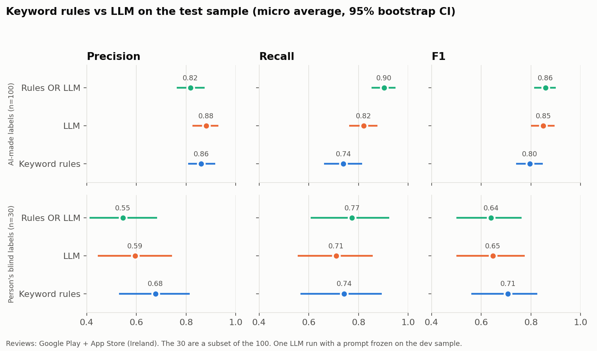

# Module 5 - LLM tagging and semantic search

**Question:** can an LLM tag reviews better than the keyword rules, and can semantic search find reviews better than keyword search?

**Short answer:** it depends on the labels used to judge it, and that is the main finding. Against the original AI-made labels the LLM looks better than the rules. Against a person's blind labels on 30 reviews it looks slightly worse. All these differences are within sampling noise. The LLM is a cheap and repeatable-enough tagger, but this work does not prove that it beats the rules.

## Data and labels

- Same 2,091 reviews as Module 1, and the same dev (100) and test (100) samples of negative reviews.
- **Label source:** the original dev and test labels were made by an AI assistant in one pass, not by a person. Older documents in this repo said "hand-labelled", which did not match how they were made. That wording was corrected on 4 Nov 2026. File and column names such as `dev_labels_manual.csv` and `hand_label_share` were kept so the scripts still run.
- **Label check:** a person blind-labelled 30 random test reviews. They saw neither the AI labels nor the rule tags, and they finished before the test run.
- Agreement between person and AI labels: **Cohen's kappa 0.67** (95% CI 0.50-0.83). The full set of labels matched on **63%** of the 30 reviews. See `label_recheck_agreement.json`.
- Labels count **problems only**. Praise gets no stage. The rules count any mention, so this slightly favours the LLM prompt, which was written to the same convention.

## Method

**LLM tagging**

- Model: `claude-haiku-5-5`, effort `low`, run on 4 Nov 2026. Output is checked with a pydantic schema, and every response is cached by (model, prompt version, review ID).
- The API rejects `temperature`, so none is set. We measured repeatability instead.
- Each label needs a quote from the review. We check that each quote is an exact substring of the review.
- Three prompt versions were tried on dev only (`llm_prompt_iterations.csv`). `journey_stage_v2` was frozen before the test run (`frozen_prompt.json`).
- No few-shot examples were used. Nothing changed after the test results were seen, and the test sample ran once (`test_run_log.json`).

**Why v2:** v2 and v3 could not be separated on dev. Micro F1 was 0.93 and 0.92, but repeat runs of the same prompt moved it by a similar amount (v2: 0.91-0.93). v2 is simpler and kept the same labels on more reviews (88% vs 85%), and all its quotes were exact.

| Prompt | Precision | Recall | Micro F1 | Macro F1 | Exact quotes |
|---|---|---|---|---|---|
| v1 | 0.76 | 0.98 | 0.86 | 0.85 | 98.8% |
| **v2 (frozen)** | 0.94 | 0.91 | 0.93 | 0.81 | 100% |
| v3 | 0.91 | 0.93 | 0.92 | 0.91 | 98.5% |

**Evaluation**

- Same stage codes and same precision and recall counts as `src/03_validate_tags.py`. The rule baseline reproduces at 0.86 / 0.74.
- 95% CIs come from 10,000 bootstrap resamples of reviews. Differences are paired, so every method is scored on the same resample.

**Semantic search**

- Local model `sentence-transformers/all-MiniLM-L6-v2`, stored in ChromaDB with retailer, store, rating, date and stage metadata.
- One query per stage was written before any results were seen (`retrieval_queries.json`).
- Only labelled reviews can be judged, so the evaluation searches the 200 dev and test reviews, with BM25 as the baseline and AI-made labels as relevance.

## Results: tagging

| Labels | Method | Precision | Recall | Micro F1 (95% CI) | Macro F1 |
|---|---|---|---|---|---|
| AI-made, n=100 | Rules | 0.86 | 0.74 | 0.80 (0.74-0.85) | 0.66 |
| | LLM | 0.88 | 0.82 | 0.85 (0.80-0.90) | 0.83 |
| | Rules OR LLM | 0.82 | 0.90 | 0.86 (0.81-0.90) | 0.81 |
| Person's blind, n=30 | Rules | 0.68 | 0.74 | 0.71 (0.56-0.83) | 0.54 |
| | LLM | 0.59 | 0.71 | 0.65 (0.50-0.78) | 0.46 |
| | Rules OR LLM | 0.55 | 0.77 | 0.64 (0.50-0.76) | 0.50 |

Paired difference in micro F1 against the rules:

| Labels | LLM - rules (95% CI) | Hybrid - rules (95% CI) |
|---|---|---|
| AI-made, n=100 | +0.05 (-0.01 to +0.11) | +0.06 (+0.02 to +0.11) |
| Person's blind, n=30 | -0.06 (-0.16 to +0.05) | -0.07 (-0.14 to +0.01) |

Only the hybrid against AI labels has a CI that excludes zero, and that gain comes with lower precision.

Per-stage counts are in `llm_vs_rules.csv`. Each stage has few cases, so per-stage scores are not reliable alone.

**Other checks on the test run**

- 0 failures of 100, and 100% of evidence quotes were exact substrings.
- Average latency was 1.85 seconds per review.
- The test run used 164,808 input and 21,560 output tokens and cost $0.03.

## What improved, what got worse, and why

Rules and LLM disagreed on 41 of the 100 test reviews (`llm_disagreements.csv`). Against the AI labels the LLM was closer on 23, the rules on 14, and 4 were ties.

**Improved against AI labels**

- Recall rose, mainly on Search & browse, Refunds & customer service, Delivery / collection and Substitutions. Macro F1 rose most, because the rules miss rare stages.
- Delivery / collection is a clear case: the rules got 1 right with 4 false tags, the LLM 4 right with none.

**Got worse**

- Pricing & loyalty: the LLM found 25 of the AI-labelled cases, the rules 30. The rules simply match words such as voucher and Clubcard well.
- Checkout & Refunds gained false tags against AI labels (2 and 4).
- On the person's labels the LLM adds more false tags: 15 against 11.

**Why the two label sets disagree**

- The biggest single cause is Refunds & customer service. The person gave this stage to none of the 30 reviews, while the LLM gave it to 6 and the AI labels to 4.
- Without that one stage the LLM and rules are almost equal on the person's labels (F1 0.71 vs 0.73). So this is largely one difference of definition, not a general failure.
- Some reviews are also genuinely open to more than one reading, such as a failure at payment that could be Checkout or App performance.

## Results: pain-point ranking

The LLM ranking (`pain_point_ranking_llm.csv`, `pain_point_ranking_compare.csv`) tells the same story as Module 1.

- Spearman rank correlation with the rules: 0.98 for all three retailers (Dunnes 0.97, SuperValu 0.94, Tesco 0.97).
- App performance stays first (31.4% vs 34.0%) and pricing second (28.9% vs 32.0%).
- At Tesco, login moves from third to second (28.3%) and pricing drops to third (25.6%).
- Average rating by stage is not comparable, because the LLM tags problems only and the rules tag any mention.
- The full run had 0 failures, 2 retries and 100% exact quotes.

## Results: semantic search

| Metric | Semantic | BM25 | Best possible | Semantic / tie / BM25 wins |
|---|---|---|---|---|
| Precision@5 | 0.74 | 0.66 | 0.96 | 4 / 4 / 2 |
| Precision@10 | 0.64 | 0.52 | 0.90 | 7 / 1 / 2 |

Semantic search did better on average, but 10 queries is a small test. BM25 won on Checkout and Substitutions at 5 results, and on Refunds and App performance at 10. Rare stages are capped by the few labelled examples: Delivery slot has only 3. See `retrieval_eval.csv`.

## Cost

Total API spend was **$0.56** by our token counts: $0.13 for prompt work on dev, $0.03 for the test run and $0.40 for the rest of the reviews. Prices are from a table cached on 6 Oct 2026, so check them against your bill. Embeddings ran locally for free.

## Limitations

- **Weak reference labels.** Most scores use AI-made labels. The same family of model made those labels and the LLM tags, so the n=100 results may be too generous.
- **Small person check.** One person labelled 30 reviews, once, with short written definitions. Their CIs are wide, and each label rests on one reading. Some labels may reflect differences of definition or slips, and nothing was changed after the results were seen.
- **Small samples.** n=100 and n=30, with very few cases for some stages (2 Basket and 2 Delivery slot in the test sample).
- **Not fully repeatable.** Rerunning the same prompt on dev changed the labels on 12% of reviews. The test scores are from one run.
- **Negative reviews only.** All checks are on 1-2 star reviews. Tags on the other 1,482 reviews are not validated.
- **Dev scores are optimistic.** The prompt was tuned on the dev sample.
- **Model and date.** Results are for `claude-haiku-5-5` on 4 Nov 2026 and may change with a new model version.
- **Reproducing the work.** Review text is not in this repo, so a fresh clone cannot rerun these results without the local data files.
- **Review selection bias** from Module 1 still applies.
- The optional RAG summary was not built.
