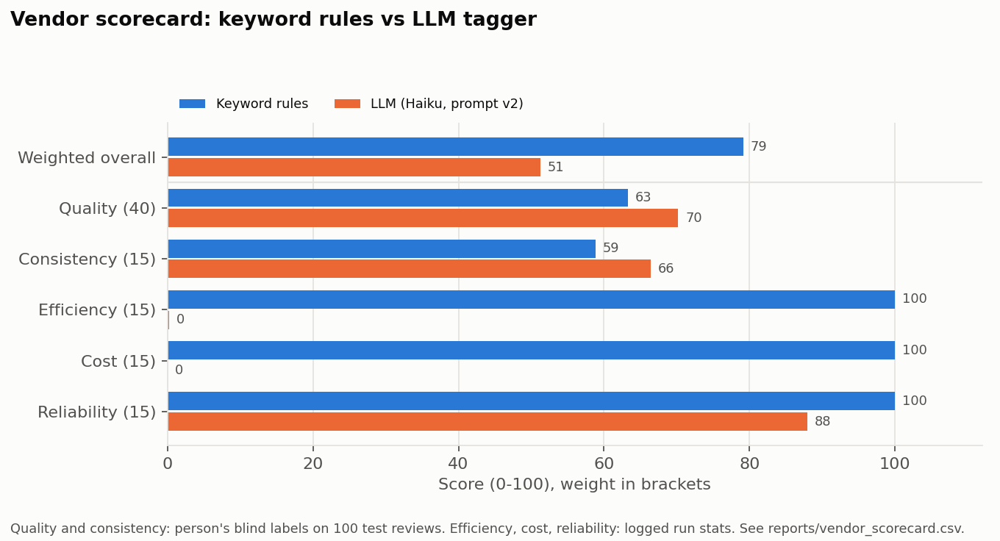

# Vendor scorecard

Made by `src/10_vendor_scorecard.py`. Weights from `config/scorecard_weights.yaml`. All numbers below are in
`reports/vendor_scorecard.csv`, `reports/vendor_scorecard_by_stage.csv` and `reports/vendor_scorecard_sensitivity.csv`
unless another file is named.
Prices behind the LLM cost are from `src/llm_client.py` and are not yet checked: **VERIFY**.

Each tagger is treated as an annotation vendor. Quality is measured only against the person's blind labels on the
100 test reviews (`reports/test_recheck_labels_100.csv`). The first 30 were labelled before the LLM test run and the
other 70 after its results were published.

## Recommendation

**Recommendation: use the LLM tagger as the main vendor, with the keyword rules as a cross-check.** With the agreed weights the rules score 79.1 and the LLM 51.2. That lead comes from cost and speed, which are scored relative to the best vendor: a free, local vendor gets full marks and any paid vendor almost none, even though the LLM costs only $0.22 per 1,000 reviews. With random weights the rules still lead in 99% of draws for the same reason. Quality is the main job of an annotation vendor, and there the LLM is better. On the person's labels for 100 reviews, micro F1 is 0.63 for the rules and 0.70 for the LLM (difference +0.07, 95% CI +0.01 to +0.13). But the gap is not stable across the two labelling rounds. On the 30 reviews labelled before the LLM test run, the rules were ahead (0.71 vs 0.65). On the 70 labelled after its results were published, the LLM was ahead (0.72 vs 0.60). So the quality lead is real on this data but not yet settled. The LLM also changed its labels on 12% of dev reviews when run again, so a repeat check and QA sampling are needed. Next step: label a fresh blind sample before looking at any tagger output, and rescore.

## Quality gap by labelling round

Source: `reports/vendor_scorecard_f1_diff.csv` (10,000 paired bootstrap resamples of reviews).

| Labels | Reviews | F1 rules | F1 LLM | LLM - rules (95% CI) |
|---|---|---|---|---|
| all 100 | 100 | 0.63 | 0.70 | +0.07 (+0.01 to +0.13) |
| first 30 (before test run) | 30 | 0.71 | 0.65 | -0.06 (-0.16 to +0.05) |
| other 70 (after results) | 70 | 0.60 | 0.72 | +0.12 (+0.06 to +0.19) |

## Scores

| Dimension (weight) | Keyword rules | LLM (Haiku, prompt v2) |
|---|---|---|
| Quality (40) | 63.3 | 70.2 |
| Consistency (15) | 58.8 | 66.4 |
| Efficiency (15) | 100.0 | 0.2 |
| Cost (15) | 100.0 | 0.0 |
| Reliability (15) | 100.0 | 87.9 |
| **Overall** | **79.1** | **51.2** |

## Raw metrics

| Metric | Keyword rules | LLM | Source |
|---|---|---|---|
| Micro precision / recall | 0.60 / 0.67 | 0.64 / 0.78 | person's labels, n=100 |
| Micro F1 (95% CI) | 0.63 (0.55-0.71) | 0.70 (0.63-0.77) | 10,000 paired bootstrap resamples |
| Micro F1, first 30 / other 70 | 0.71 / 0.60 | 0.65 / 0.72 | labelling rounds |
| Macro F1 | 0.49 | 0.56 | stages with no cases are skipped |
| Kappa vs person (95% CI) | 0.59 (0.50-0.67) | 0.66 (0.59-0.74) | over 100 x 10 review-stage cells |
| Reviews per minute | 21,122 | 44.1 | rules: `reports/vendor_timing_rules.json`; LLM: 60 / mean latency in `reports/llm_run_all_journey_stage_v2.json` |
| Cost per 1,000 reviews (USD) | 0.00 | 0.2173 | LLM: `cost_usd` / `reviews` in `reports/llm_run_all_journey_stage_v2.json`. Prices: VERIFY |
| Failure rate | 0.0% | 0.0% | `reports/llm_run_all_journey_stage_v2.json` |
| Retry rate | 0.0% | 0.1% | same; retry reasons were not logged |
| Inexact-quote rate | n/a (no quotes) | 0.0% | same |
| Repeat-run change rate | 0.0% | 12.0% | rules: rerun on all 2,091 here; LLM: `reports/frozen_prompt.json` (100 dev reviews) |

- Kappa difference, LLM minus rules: +0.01 to +0.14 (95% CI).
- Agreement between the two vendors: kappa 0.73 on the 100 test reviews and
  0.64 on all 2,091 reviews. They give a different label set on
  34% of all reviews. Part of this is by design: the rules tag any
  mention, the LLM tags problems only, and most of the 2,091 reviews are positive.
- Refusals are not counted separately. A refusal would be retried, and there were 2 retries
  with no logged reason. NOT AVAILABLE.

## Weight sensitivity

| scenario | overall_rules | overall_llm | winner |
|---|---|---|---|
| agreed weights | 79.1 | 51.2 | rules |
| equal weights | 84.4 | 44.9 | rules |
| quality only | 63.3 | 70.2 | llm |
| quality + consistency only | 61.1 | 68.3 | llm |
| without quality | 89.7 | 38.6 | rules |
| without consistency | 82.7 | 48.6 | rules |
| without efficiency | 75.5 | 60.3 | rules |
| without cost | 75.5 | 60.3 | rules |
| without reliability | 75.5 | 44.8 | rules |
| random weights (10,000 draws) |  |  | rules 99.4%; llm 0.6%; tie 0.0% |

## How to read this

- Efficiency and cost are relative to the best vendor. With two vendors and one of them free and local, these two
  dimensions give the rules full marks and the LLM almost none. The sensitivity table shows what happens without them.
- LLM speed is per worker. The run used 8 parallel workers, but the wall-clock time was not logged, so real throughput
  is NOT AVAILABLE.
- The rules timing was measured on 2026-11-17 on one laptop. It is kept in `reports/vendor_timing_rules.json` so
  reruns give the same scores. Run with `--retime` to measure again.
- Per-stage results are in `reports/vendor_scorecard_by_stage.csv`. Rare stages have 1-3 person labels, so per-stage scores are not reliable alone.
- The LLM prompt follows the "problems only" rule used for the labels. The rules count any mention. This favours the LLM a little.
