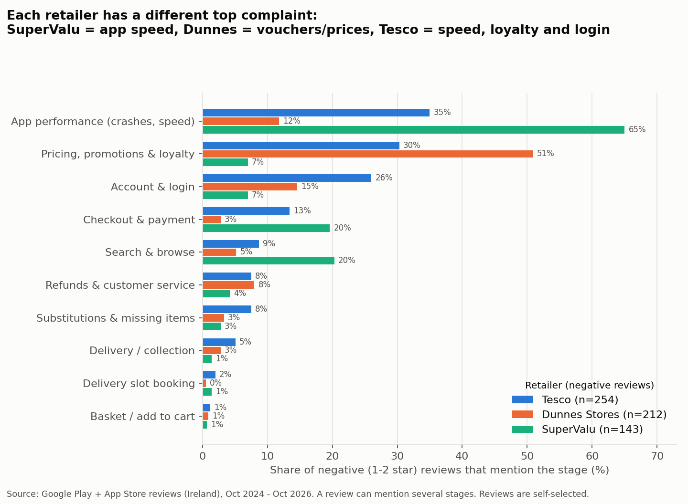
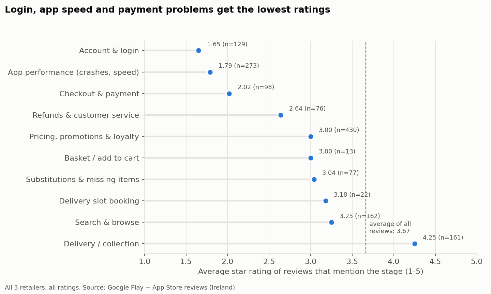

# Module 1 - Voice of Customer: what are app users complaining about?

## Data

- **2,091 English app reviews** from the last 24 months (27 Oct 2024 - 25 Oct 2026), collected on 26 Oct 2026.
- Three Irish grocery apps, from Google Play (Ireland store) and the App Store (Ireland store):

| Retailer | Google Play app | App Store app | Reviews | Negative (1-2 stars) | Average rating |
|---|---|---|---|---|---|
| Tesco Ireland | `com.puca.tesco` | `648859363` | 933 | 254 (27%) | 3.74 |
| Dunnes Stores | `com.dunnes.valueclubcard` | `1539398657` | 892 | 212 (24%) | 3.87 |
| SuperValu | `com.ammeon.supervalu` | `538805121` | 266 | 143 (54%) | 2.70 |

- We checked the app IDs by publisher name. `com.tesco.grocery.view` is the **UK** Tesco app, so we did not use it.
- Apple's feed only gives the 500 most recent reviews per app, so App Store numbers are smaller.

**Important limits**

- **Selection bias:** people choose to write reviews. Unhappy users write more. These numbers show what reviewers say, not what all customers feel.
- The Dunnes Stores and Tesco apps are also used **in store** (loyalty card, vouchers). So not every review is about online shopping. 7.6% of negative reviews clearly talk about using the app in a store.
- Google Play does not fully filter reviews by country, so a few reviews may come from outside Ireland.

## Method

1. **Clean:** remove empty reviews, join title + text, check language. (All 2,091 were English. The language detector is weak on short texts, so we only trust it on 5+ word reviews.)
2. **Tag journey stages with keyword rules** (`src/journey_rules.py`). One review can have several stages.
3. **Check the rules by hand:**
   - Dev sample: 100 random negative reviews, labelled by hand, used to improve the rules.
   - Test sample: a new set of 100 random negative reviews, labelled by hand, **not** used to write the rules.
   - On the test sample: **precision 0.86, recall 0.74** (all stages together). See `reports/tag_validation.csv`.
   - Stage shares from the rules and from the hand labels are very close on the 200 hand-labelled reviews (`reports/pain_point_hand_vs_rules.csv`), so the ranking is stable.
4. **Sentiment:** star rating plus a VADER score. They agree well (correlation 0.71).
5. **What the rules miss:** 19.5% of negative reviews get no tag. A topic model (LDA) and word counts show these are mostly short, general reviews ("awful app") plus small themes (store staff, digital receipts, notifications). No big missed theme.

## Results

Share of the 609 negative reviews that mention each stage (all three retailers):

| Rank | Stage | Share of negative reviews | 95% CI | Avg rating when mentioned (all reviews) |
|---|---|---|---|---|
| 1 | App performance (crashes, speed) | 34.0% | 30.3-37.8% | 1.79 |
| 2 | Pricing, promotions & loyalty | 32.0% | 28.4-35.8% | 3.00 |
| 3 | Account & login | 17.6% | 14.8-20.8% | 1.65 |
| 4 | Checkout & payment | 11.2% | 8.9-13.9% | 2.02 |
| 5 | Search & browse | 10.2% | 8.0-12.8% | 3.25 |
| 6 | Refunds & customer service | 6.9% | 5.1-9.2% | 2.64 |
| 7 | Substitutions & missing items | 4.9% | 3.5-6.9% | 3.04 |
| 8 | Delivery / collection | 3.4% | 2.3-5.2% | 4.25 |
| 9 | Delivery slot booking | 1.3% | 0.7-2.6% | 3.18 |
| 10 | Basket / add to cart | 1.0% | 0.5-2.1% | 3.00 |

**Each retailer has a different main problem:**

- **SuperValu:** app performance is in 65% of negative reviews (slow loading, freezing). Search & browse (20%) and checkout & payment (20%) come next.
- **Dunnes Stores:** pricing, vouchers and loyalty are in 51% of negative reviews (voucher value, short expiry dates). This is mostly a commercial policy issue, not a UX bug.
- **Tesco:** app performance (35%), pricing/loyalty (30%) and account & login (26%). Many login complaints are about being logged out, or having to re-verify the Clubcard, while standing at the till.

**Delivery is not the main pain point in app reviews.** Reviews that mention delivery have a high average rating (4.25), so many of them are praise. (The delivery rule is also the weakest rule: few hand-labelled cases, so treat this stage with care.)

## Top 3 pain points as testable hypotheses

We picked stages that (a) are common, (b) come with very low ratings, and (c) a product team can fix and test. Pricing/loyalty is common, but it is a pricing policy question more than a journey problem, so it is not in the list.

1. **Checkout & payment** (11.2% of negative reviews, average rating 2.02; SuperValu 20%, Tesco 13%).
   Reviews describe failed bank verification, being sent out of the app to the bank, and re-entering saved cards.
   *Hypothesis:* If we add a one-tap wallet payment (Apple Pay / Google Pay) at checkout, more users who start payment will finish the order.
   *Metric:* payment step -> purchase conversion. This links directly to the `add_payment_info -> purchase` step in Module 2.
2. **Account & login** (17.6%, average rating 1.65 - the lowest of all stages; Tesco 26%).
   *Hypothesis:* If we keep users signed in (longer sessions + biometric login) instead of forcing a full re-login, more sessions will reach the basket and checkout, and login complaints will fall.
3. **App performance** (34.0%, average rating 1.79; SuperValu 65%).
   *Hypothesis:* If we make product list and basket pages load faster (for example, under 2 seconds), more sessions will add items to the basket and reach checkout.

Module 4 designs an A/B test for hypothesis 1, because Module 2 gives a real baseline for that exact funnel step.

## Context sources (cited, not scraped)

- Tesco Ireland help pages on delivery, Click & Collect and substitutions: https://www.tesco.ie/help (the site blocks automated checks; open it in a browser to confirm the page before citing a detail from it)
- Baymard Institute research on online grocery UX (used as a framework only): https://baymard.com/research/online-grocery
