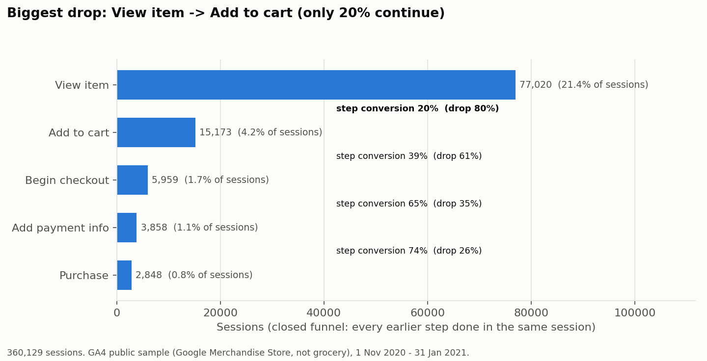
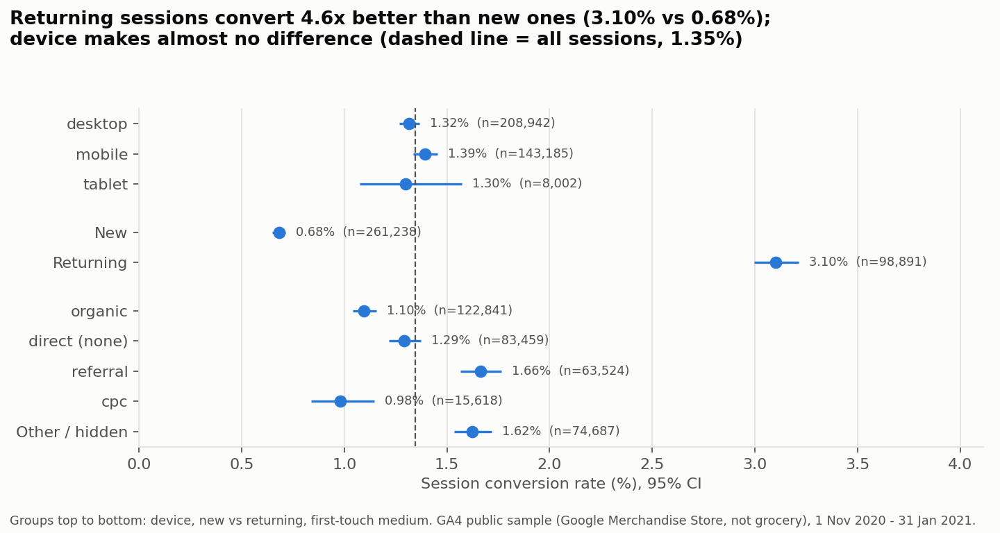
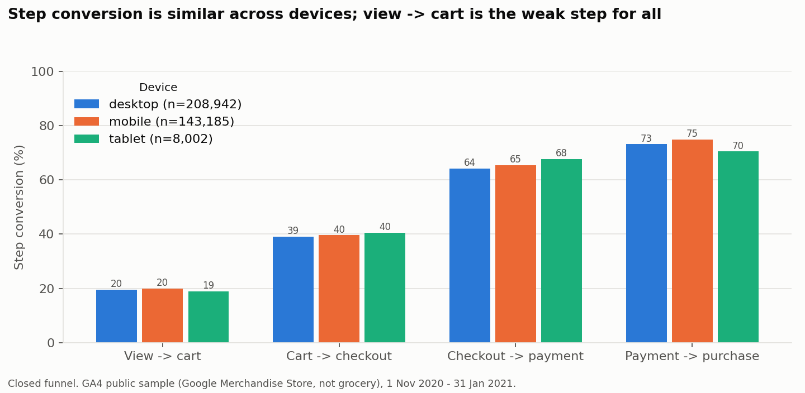

# Module 2 - Web funnel and conversion (real e-commerce web analytics data)

## Data and provenance

- BigQuery public dataset `bigquery-public-data.ga4_obfuscated_sample_ecommerce`.
- It is the **Google Merchandise Store**: a real online shop that sells Google-branded products. **It is not a grocery store.** We use it as real e-commerce web analytics data, because no public grocery web-analytics dataset exists.
- Period: 1 Nov 2020 - 31 Jan 2021 (it includes the Black Friday and Christmas peak).
- Google obfuscated the data, so some traffic sources show as `<Other>` or `(data deleted)`, and 402 purchases have $0 revenue.
- One SQL query (`sql/01_session_funnel.sql`) builds a session-level table. It scans 1.16 GB (inside the free BigQuery sandbox).
- Result: **360,129 sessions** from **270,154 users**.

## Method

- A session = `user_pseudo_id` + `ga_session_id`.
- Funnel steps: `view_item` -> `add_to_cart` -> `begin_checkout` -> `add_payment_info` -> `purchase`.
- **Closed funnel** (main view): a session counts at a step only if it did every earlier step in the same session.
- **Open funnel**: any session with the event. We show it because 2,000 of the 4,848 purchasing sessions had no `add_to_cart` in the same session (the basket was likely filled in an earlier visit).
- Cart abandonment = share of sessions with `add_to_cart` that do not purchase.
- AOV = revenue / purchase events (removing $0 purchases).
- Segments: device, first-touch medium (how the user was first acquired), new vs returning session. 95% CIs (Wilson); chi-square tests for differences.

## Results

| Step | Sessions (closed) | Step conversion (closed) | Sessions (open) |
|---|---|---|---|
| View item | 77,020 | 21.4% of all sessions | 77,020 |
| Add to cart | 15,173 | 19.7% | 15,188 |
| Begin checkout | 5,959 | 39.3% | 11,106 |
| Add payment info | 3,858 | 64.7% | 6,815 |
| Purchase | 2,848 | 73.8% | 4,848 |

**Key rates (all sessions)**

| Metric | Value |
|---|---|
| Overall session conversion | **1.35%** (4,848 / 360,129) |
| Cart abandonment | **81.2%** |
| Checkout abandonment (began checkout, no purchase) | 56.4% |
| Payment info -> purchase | **71.1%** (so 28.9% drop at the last step) |
| AOV | **$68.97** |

**Biggest drop-off stage: view item -> add to cart.** Only 19.7% of sessions that view an item add one to the cart. After the cart, the largest drop is cart -> checkout (39% continue in the closed funnel).

**Segments**

| Segment | Sessions | Conversion | Cart abandonment | Checkout -> payment | Payment -> purchase (open) | AOV |
|---|---|---|---|---|---|---|
| Desktop | 208,942 | 1.32% | 81.7% | 64.1% | 70.7% | $69.58 |
| Mobile | 143,185 | 1.39% | 80.6% | 65.5% | 71.7% | $68.20 |
| Tablet | 8,002 | 1.30% | 80.7% | 67.7% | 68.4% | $67.16 |
| **New session** | 261,238 | **0.68%** | **87.4%** | **48.4%** | 67.8% | $64.48 |
| **Returning session** | 98,891 | **3.10%** | 72.6% | 83.4% | 73.1% | $71.49 |
| Referral | 63,524 | 1.66% | 79.0% | 69.6% | 71.9% | $72.00 |
| Organic | 122,841 | 1.10% | 83.1% | 61.7% | 69.5% | $71.48 |
| Paid search (cpc) | 15,618 | 0.98% | 83.7% | 58.7% | 70.8% | $58.05 |

- **Device does not matter much here.** Conversion is 1.30-1.39% on all devices (chi-square p = 0.14), and payment -> purchase does not differ by device (p = 0.51). This differs from the common belief that mobile converts worse.
- **New vs returning is the biggest gap.** Returning sessions convert 4.6 times better (3.10% vs 0.68%). For new users, the checkout -> payment step is only 48% (returning: 83%), so **new users at checkout are the weakest segment**.
- Paid search (cpc) brings the lowest conversion (0.98%) and the lowest AOV ($58.05).

## Link to Module 1 (app reviews)

- Module 1 found **checkout & payment** complaints in 11.2% of negative app reviews (average rating 2.02). Here, **28.9% of sessions that enter payment info still do not buy**, and new users lose more than half of sessions between checkout and payment. Both point to payment friction as a real, measurable problem.
- Module 1's **login** complaints fit the new-vs-returning gap: first-time users must create an account or sign in at checkout, and their checkout -> payment rate is much lower.
- Module 1's **app performance and search** complaints fit the big view -> cart drop. But this dataset cannot show page speed, so we cannot test that link directly.
- Caution: Module 1 is about grocery **apps** in Ireland; Module 2 is a **website** selling merchandise in another market. The link is about the type of friction, not the exact numbers.

## Baselines for Module 4

Saved in `reports/m2_baselines.json`:

- Payment info -> purchase conversion: **71.1%**
- Sessions with payment info: 6,815 in 92 days (about **520 per week**)
- Sessions: about 27,500 per week
- AOV: $68.97
