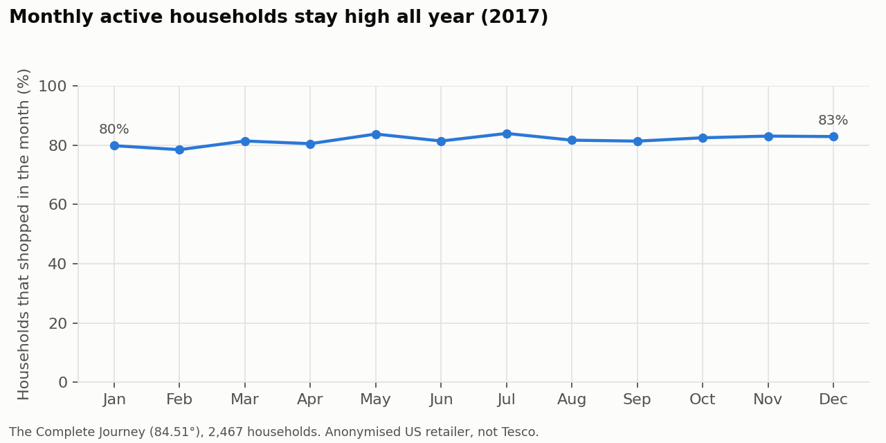
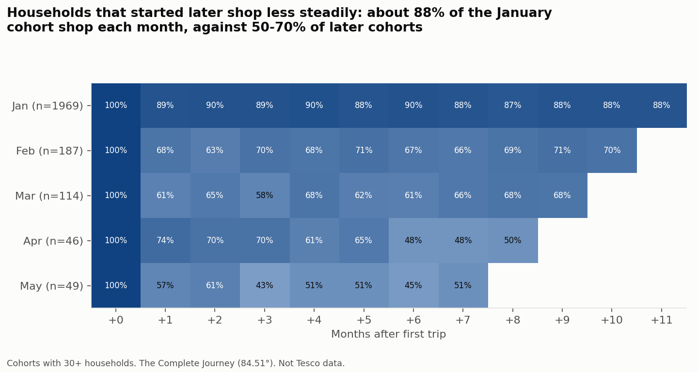
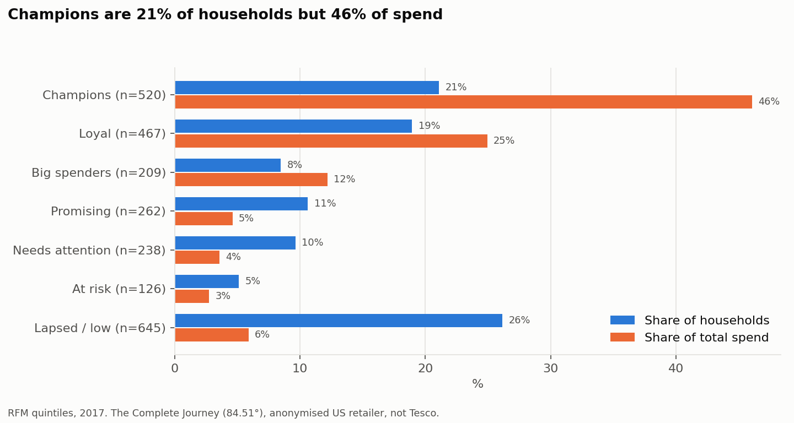
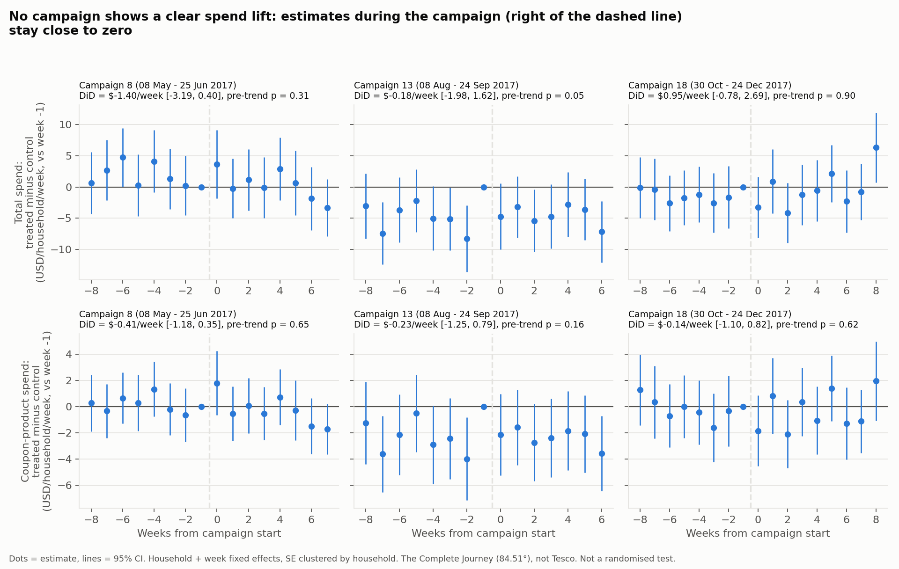
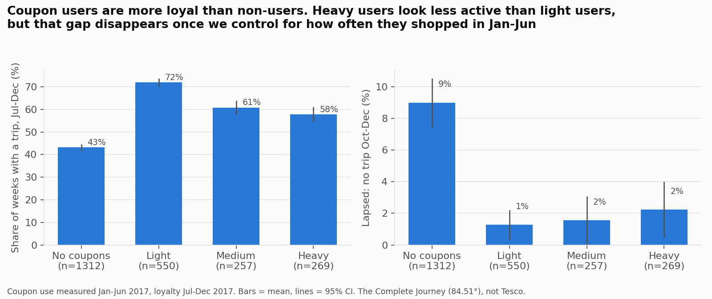

# Module 3 - Customers, CRM and promotions (real retail data)

## Data and provenance

- **The Complete Journey, 84.51° release**, from the open `completejourney` R package.
- Grocery shopping of **2,469 households** at one **anonymised US retailer** for **calendar year 2017**.
- **This is not Tesco data.** (84.51° began as dunnhumby's US joint venture with Kroger. dunnhumby runs Tesco Clubcard analytics. That is background only.)
- The project brief expected dunnhumby's older release (about 2,500 households, two years). The open package has the 84.51° release instead, so all numbers here use it.
- Tables used: transactions (1,469,307 lines), products, campaigns, campaign descriptions, coupons, coupon redemptions, demographics (801 households only).
- Cleaning: we removed FUEL and MISCELLANEOUS lines (17,868 lines), because their "quantity" is not an item count (fuel lines go up to 89,638). We also removed zero-quantity lines. Result: **141,029 baskets from 2,467 households** in 2017.

## 1. Retail KPIs (2017)

| KPI | Value |
|---|---|
| Households | 2,467 |
| Baskets (shopping trips) | 141,029 |
| AOV (average spend per basket) | $29.68 (median $16.00) |
| Items per basket | 13.5 (median 7) |
| Baskets per household per year | 57.2 (median 40) |
| Spend per household per year | $1,697 |
| Days between trips | median 4, mean 6.7 |
| Baskets that used a coupon | 5.8% |
| Households that used a coupon at least once | 59.0% |

Source: `reports/m3_kpis.csv`.

## 2. Retention

- About **80-84%** of households shop in any given month, and the rate is flat all year.
- 9.1% of households made their last trip before 1 November (lapsed by year end).
- Cohorts: 1,969 households (80%) first appear in January. The January cohort stays very steady (about 88% shop each month). Households that first appear later are less steady (about 50-70% each month).
- Limit: this panel was built from frequent shoppers, so it is not a sample of brand-new customers. The cohort view mostly shows how steady different groups are, not true new-customer churn.

## 3. RFM segmentation

Each household gets a 1-5 score for **Recency** (days since last trip), **Frequency** (trips) and **Monetary** (spend), using quintiles. The score patterns map to 7 named segments.

| Segment | Households | Share of households | Share of spend | Median trips | Median spend | AOV | Coupon basket share |
|---|---|---|---|---|---|---|---|
| Champions | 520 | 21.1% | 46.0% | 97 | $3,130 | $34.38 | 7.7% |
| Loyal | 467 | 18.9% | 24.9% | 73 | $1,704 | $27.34 | 5.0% |
| Big spenders | 209 | 8.5% | 12.2% | 41 | $2,155 | $66.51 | 10.5% |
| Promising | 262 | 10.6% | 4.6% | 28 | $704 | $27.38 | 4.3% |
| Needs attention | 238 | 9.6% | 3.6% | 25 | $568 | $26.57 | 3.6% |
| At risk | 126 | 5.1% | 2.7% | 39 | $949 | $23.45 | 4.8% |
| Lapsed / low | 645 | 26.1% | 5.9% | 12 | $279 | $29.68 | 3.8% |

- **Champions + Loyal = 40% of households and 71% of spend.**
- **Big spenders** make fewer trips but spend the most per trip ($66.51 AOV), and use coupons most (10.5% of baskets).
- **At risk** households used to shop often (median 39 trips) but their median last trip was 21 days before year end.
- Demographics exist for only 801 households, and mostly for engaged ones (346 of 520 Champions vs 9 of 645 Lapsed). So demographic profiles are only shown in `reports/m3_rfm_segments.csv` and are not reliable for the low segments.

## 4. Campaign uplift (difference-in-differences)

**Question:** did households that were sent a campaign spend more during it?

**Design:** the three large "Type A" campaigns (8, 13 and 18), each sent to about 1,100 households.

- Treated: households sent the campaign. Control: households not sent it.
- Robustness control: the 908 households that got no campaign at all in 2017.
- 8 weeks before the campaign vs the campaign weeks.
- Two outcomes: total weekly spend, and weekly spend on the products covered by the campaign's coupons.
- Model: household + week fixed effects, standard errors clustered by household.
- Parallel-trends check: an event study of the pre-campaign weeks.

| Campaign | Dates (2017) | Outcome | DiD (USD per household per week) | 95% CI | Pre-trend test p |
|---|---|---|---|---|---|
| 8 | 8 May - 25 Jun | Total spend | -1.40 | -3.19 to 0.40 | 0.31 |
| 8 | | Coupon-product spend | -0.41 | -1.18 to 0.35 | 0.65 |
| 13 | 8 Aug - 24 Sep | Total spend | -0.18 | -1.98 to 1.62 | 0.05 |
| 13 | | Coupon-product spend | -0.23 | -1.25 to 0.79 | 0.16 |
| 18 | 30 Oct - 24 Dec | Total spend | +0.95 | -0.78 to 2.69 | 0.90 |
| 18 | | Coupon-product spend | -0.14 | -1.10 to 0.82 | 0.62 |

**Result: no campaign shows a clear spend lift.** Every 95% confidence interval includes zero. The best case (campaign 18, total spend) is +$0.95 per household per week, or +1.9% of the treated group's pre-campaign spend, and it is not significant. Results with the "never targeted" control group are similar (`reports/m3_campaign_did.csv`).

**Assumptions and limits**

- This is **not a randomised experiment.** The retailer chose who got each campaign. Targeted households already spent about 3 times more than control households ($50 vs $17 per week before the campaign). DiD removes that level gap but needs parallel trends.
- The pre-trend test passes for campaigns 8 and 18. For campaign 13 it is borderline (p = 0.05), and it fails with the never-targeted control (p = 0.003), so campaign 13 results are the least reliable.
- Other campaigns ran at the same time, so the control group is not "untouched".
- Coupons cover a very large set of products (17,000-36,000 per campaign), so the "coupon-product spend" outcome is still broad.
- Small effects (about $1-2 per week) could be missed. The confidence intervals are about +/- $1.80 per week for total spend.

## 5. Coupon dependency vs loyalty

**Question:** are heavy coupon users less loyal? An earlier project (`github.com/Newnew-niu/ecommerce-repeat-purchase-analysis`) found this on **simulated** data. Here we test it on **real** data.

**Design (avoids a circular result):**

- Coupon dependency is measured in **Jan-Jun 2017**: the share of a household's baskets with a coupon.
- Loyalty is measured in **Jul-Dec 2017**: trips, share of weeks with a trip, and lapsed (no trip in Oct-Dec).
- 2,388 households that shopped in Jan-Jun. 1,076 (45.1%) used coupons.

| Group (Jan-Jun coupon basket share) | Households | Median trips Jan-Jun | Share of weeks with a trip Jul-Dec | Lapsed (no trip Oct-Dec) |
|---|---|---|---|---|
| No coupons (0%) | 1,312 | 12.5 | 43.1% | 9.0% |
| Light (up to 7.7%) | 550 | 39 | 71.9% | 1.3% |
| Medium (7.7-15.4%) | 257 | 24 | 60.8% | 1.6% |
| Heavy (above 15.4%) | 269 | 22 | 57.7% | 2.2% |

**Results**

- Coupon users of every level are **more** loyal than non-users (more active weeks, lapse rate 1-2% vs 9%).
- Among coupon users, heavier users look *less* active than light users (Spearman rho = -0.30). But heavy users also made fewer trips in Jan-Jun. Coupon share is a ratio: fewer trips push it up.
- After controlling for Jan-Jun trips and spend, **+10 percentage points of coupon use goes with slightly MORE loyalty**:
  - +1.4 points in the share of active weeks (95% CI +0.7 to +2.2, p < 0.001)
  - lower odds of lapsing (odds ratio 0.78, 95% CI 0.61 to 1.00, p = 0.049)
- **Conclusion: the "coupon users are less loyal" finding from the simulated project does NOT hold on this real data.** The raw negative pattern is explained by shopping frequency (a confounder).
- Limits: this shows association, not cause. Coupon users may simply be more engaged customers. We cannot see coupons that were offered but not used.

## CRM recommendations (for an online grocery retailer)

These come from this US dataset. They would need testing on the retailer's own customers.

1. **Protect Champions and Loyal (40% of households, 71% of spend).** Use service and recognition (for example priority delivery slots, early access to offers), not deep discounts. Their spend did not move with broad campaigns.
2. **Win back "At risk" households (126 households, median 39 trips, but quiet for about 3 weeks).** Use a time-triggered message after a longer-than-usual gap. The median gap between trips is only 4 days, so 2-3 weeks of silence is a clear signal.
3. **Grow "Big spenders" (AOV $66.51, fewer trips).** Use offers that reward a second trip in the week, and they already respond to coupons.
4. **Do not cut coupons on the fear that they make customers disloyal.** This data does not support that.
5. **Measure campaigns with holdout groups.** The broad Type A campaigns show no measurable spend lift. A random holdout (a small share of targeted customers who get nothing) would give a clean answer next time. Module 4 shows how to design such a test.
