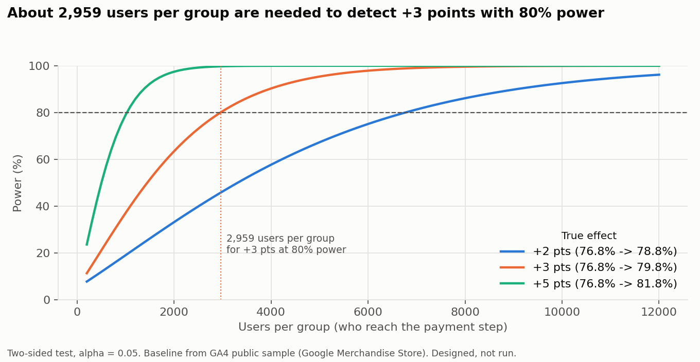

# Module 4 - A/B test design: one-tap wallet payment at checkout

> **This test is designed, not run.** The baselines are real (GA4 public sample, Module 2). The only results shown are a clearly labelled simulation of how the analysis would work.

## Why this test

- **Module 1:** checkout & payment problems are in 11.2% of negative app reviews, with an average rating of 2.02. Reviews describe failed bank verification, being sent out of the app to the bank, and re-entering saved cards. SuperValu (20%) and Tesco (13%) have the most of these complaints.
- **Module 2:** 28.9% of sessions that enter payment info still do not buy (session level). This is a measurable drop at the very last step.
- We chose this pain point (out of the top 3) because the change is small and contained, and Module 2 gives a real baseline for exactly this step. The other two options were login (keep users signed in) and app speed.

## Experiment plan

| Item | Plan |
|---|---|
| **Hypothesis** | If we add one-tap wallet payment (Apple Pay / Google Pay) on the payment step, more users who reach that step will complete the purchase, because they skip card entry and the bank redirect. |
| **Control (A)** | Current payment page (card entry). |
| **Treatment (B)** | Same page plus Apple Pay / Google Pay buttons at the top. |
| **Unit of randomisation** | **User** (logged-in customer ID; device cookie if not logged in). One person always sees the same version, on every visit. |
| **Who is analysed** | Only users who reach the payment step during the test ("triggered" users), because the change is only visible there. Assignment happens before that, so both groups are comparable. |
| **Eligibility** | Wallet payment only works on supported devices and browsers. Eligibility is checked the same way in both groups: control users on supported devices are eligible but see no button. We analyse eligible users. |
| **Primary metric** | **Payment-step completion:** share of triggered users who purchase during the test. Baseline: **76.8%** (user level, GA4). |
| **Secondary metrics** | Time from payment step to order; payment error rate; share of orders paid by wallet (adoption). |
| **Guardrail metrics** | AOV must not drop by more than 2%; overall conversion must not fall; payment page load time; failed or refunded payments; payment-related customer service contacts. |
| **Split** | 50 / 50. |
| **Significance level** | alpha = 0.05, two-sided. |
| **Power** | 80%. |
| **Minimum detectable effect (MDE)** | **+3 percentage points** (76.8% -> 79.8%, +3.9% relative). |
| **Sample size** | **2,959 users per group, 5,918 in total** (statsmodels `NormalIndPower`, Cohen's h). |
| **Duration** | At GA4-sample traffic (about 438 users reach payment per week), 14 weeks. For a bigger retailer: weeks = 5,918 / (users reaching payment per week), **with a minimum of 2 full weeks** to cover weekday/weekend patterns. |

### Sample size for other effect sizes

| MDE (points) | Target rate | Users per group | Weeks at GA4 traffic |
|---|---|---|---|
| +2 | 78.8% | 6,771 | 31 |
| **+3** | **79.8%** | **2,959** | **14** |
| +4 | 80.8% | 1,635 | 8 |
| +5 | 81.8% | 1,027 | 5 |

**Why the triggered analysis matters:** if we measured purchase across **all** users instead, the same gain would be diluted by everyone who never reaches the payment step. The test would then need about **631,000 users per group** (1.26 million in total) instead of 2,959 (see `reports/m4_power_table.csv`).

## Decision rules (agreed before the test starts)

1. **Check the split first.** If the 50/50 allocation is off (SRM chi-square test, p < 0.001), stop and fix tracking. Do not read the results.
2. **No peeking.** Run to the planned sample size. Do not stop early because the result "looks significant".
3. **Ship** if the primary metric is significantly higher (p < 0.05 and the 95% CI is above 0) **and** no guardrail is significantly worse (AOV not down more than 2%).
4. **Do not ship** if the primary metric is significantly lower, or a guardrail is harmed.
5. **No clear result** (not significant): keep the current page. If adoption is high and guardrails are fine, consider a longer follow-up test. A non-significant result is not proof of "no effect".
6. Only one primary metric, so no correction is needed for it. Secondary metrics use a Holm correction and count as supporting evidence only.

## Risks and how we handle them

| Risk | What could go wrong | How we handle it |
|---|---|---|
| **Novelty effect** | People try the new button because it is new, then stop. | Run at least 2 full weeks; compare week 1 with week 2+; track repeat wallet use. |
| **Seasonality** | Christmas or payday weeks change behaviour. The GA4 baseline itself comes from Nov-Jan (peak season). | Avoid starting in peak weeks; run full weeks; both groups face the same calendar, so the comparison stays fair. Re-check the baseline in the first week. |
| **Multiple testing** | Many metrics, so one looks "significant" by chance. | One pre-registered primary metric; Holm correction for secondaries. |
| **Device mix** | Wallet buttons only show on supported devices. | Check eligibility the same way in both groups; report results by device as a secondary view. |
| **Cross-device users** | A logged-out user may land in both groups. | Randomise on customer ID where possible; drop users seen in both groups and report how many. |
| **Interference with other tests** | Another checkout test runs at the same time. | Keep this test separate from other checkout tests, or randomise them independently and check for interaction. |
| **Low traffic** | A small site needs a long test (14 weeks here). | Accept a larger MDE (+5 points takes 5 weeks), or run on the app and web together. |

## Simulated analysis example (NOT real results)

`src/31_ab_test_simulated_analysis.py` simulates one test with a true +3 point lift, the planned sample size and the real 76.8% baseline (seed 2026), then analyses it:

- SRM check: 2,926 vs 2,992 users, p = 0.391 -> split OK.
- Primary metric: 77.10% vs 78.74%, difference +1.64 points, 95% CI [-0.47, +3.75], p = 0.128 -> **not significant**.
- Guardrail AOV: $69.95 vs $71.22, p = 0.580 -> no harm.
- Decision: **do not ship / keep testing** under the rules above.
- Repeating the simulated test 2,000 times detects the true +3 points in **80.6%** of runs, matching the planned 80% power.

**The lesson:** even with a real effect and a correct design, about 1 test in 5 misses it. That is why we fix the sample size in advance and do not re-run until we get the answer we want.
